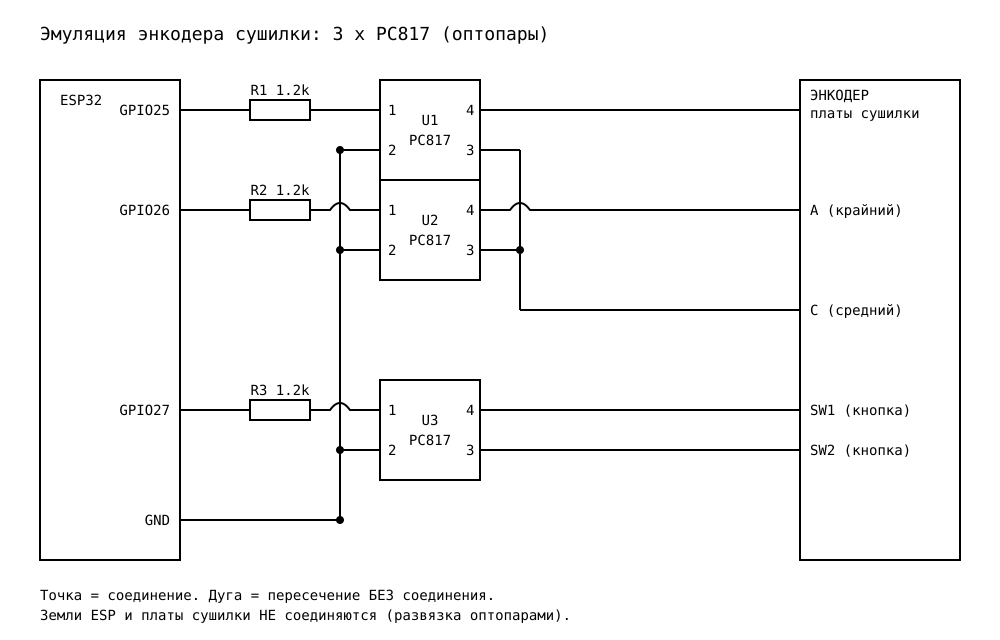
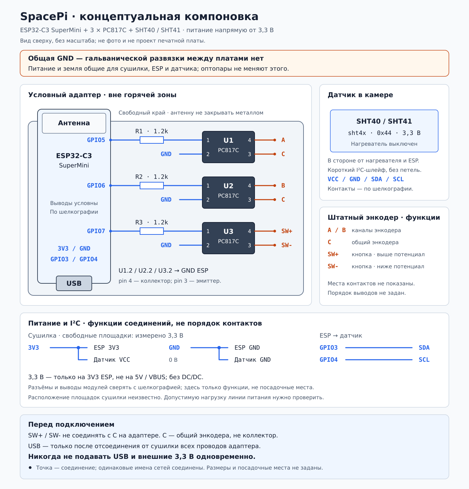

# Creality SpacePi SE + ESPHome

Управление сушилкой **Creality SpacePi SE / DryerBox_2.0** через ESP32-C3 SuperMini: три оптопары эмулируют поворот и нажатие штатного энкодера. Родная плата и её прошивка остаются без изменений. Управление доступно из Home Assistant и браузера; SHT40/SHT41 добавляет измерение температуры и влажности.

- [Конфиг ESPHome — drybox-filament.yaml](firmware/drybox-filament.yaml)
- [Схема подключения](schema.svg) · [Компоновка](docs/layout-proposal.svg) · [Замечания по монтажу](docs/layout-proposal.md)

## Компоненты

- ESP32-C3 SuperMini.
- Три PC817C в корпусах DIP-4 и три резистора по 1,2 кОм.
- Модуль SHT40 или SHT41, совместимый с питанием и уровнями I²C 3,3 В.
- Монтажная плата, разъёмы и изолированный провод.

## Подключение



### Питание

В текущей сборке ESP работает от свободных площадок штатной платы, на которых измерено **3,3 В**:

```text
Плата сушилки                 ESP32-C3 SuperMini       SHT40 / SHT41
Стабилизированные +3,3 В ──── 3V3 ─────────────────── VCC
Общий 0 В ────────────────── GND ─────────────────── GND
```

**На штатной плате есть сетевое напряжение.** Пайка и подключение — только при отключённой вилке и после безопасного разряда конденсаторов. Расположение площадок питания зависит от ревизии; на схеме оно намеренно не указано.

- До повторения сборки нужно подтвердить назначение площадок, изоляцию низковольтного источника от сети и запас его мощности для ESP с Wi-Fi и датчика. Одного измерения 3,3 В недостаточно.
- Питание подаётся на **3V3**, не на `5V/VBUS`. Напряжение 5 В на `3V3` недопустимо.
- Земли ESP и сушилки соединены через питание: **гальваноразвязки между платами нет**, несмотря на оптопары.
- Для прошивки по USB полностью отсоединить адаптер от сушилки. Не подключать одновременно USB и внешние 3,3 В.

### Энкодер

Припаиваться к подписанным площадкам SuperMini. Номера GPIO — маркировка выводов, а не порядковые номера отверстий.

| GPIO ESP | Вход оптопары через резистор | Выход к штатному энкодеру |
|---|---|---|
| GPIO5 | R1 → U1, pin 1 | pin 4 → A; pin 3 → общий C |
| GPIO6 | R2 → U2, pin 1 | pin 4 → B; pin 3 → общий C |
| GPIO7 | R3 → U3, pin 1 | pin 4 → SW+; pin 3 → SW− |

Pin 2 всех трёх PC817 соединяется с GND ESP. У PC817 pin 4 — коллектор, pin 3 — эмиттер; SW+ обозначает более положительный контакт кнопки. Оптопары подключаются **параллельно** контактам энкодера, штатная ручка сохраняется. SW− и C на адаптере дополнительно не объединять.

### Температура и влажность

| SHT40 / SHT41 | ESP32-C3 SuperMini |
|---|---|
| VCC | 3V3 |
| GND | GND |
| SDA | GPIO3 |
| SCL | GPIO4 |

Драйвер ESPHome — `sht4x`, адрес по умолчанию `0x44`, опрос каждые 10 секунд, встроенный нагреватель датчика выключен. Подтяжки SDA/SCL должны идти к **3,3 В**; если на модуле их нет, нужны внешние, обычно 4,7 кОм.

Разместить датчик в камере, вдали от нагревателя, горячей струи и ESP. Провода I²C держать короткими и вдали от силовых цепей. Подключение датчика добавлено в конфиг, но на этой сборке ещё не проверено. До его установки можно убрать блоки `i2c:` и `sensor:`.

## Прошивка

1. В ESPHome Device Builder **2026.9.0 или новее** создать устройство `drybox-filament` и перенести содержимое [конфига](firmware/drybox-filament.yaml).
2. В `secrets.yaml` рядом с конфигом добавить свои значения; существующие секреты не перезаписывать:

   ```yaml
   wifi_ssid: "YOUR_WIFI_SSID"
   wifi_password: "YOUR_WIFI_PASSWORD"
   wifi_ap_password: "YOUR_AP_PASSWORD"
   api_key: "YOUR_32_BYTE_BASE64_KEY"
   ```

   Пароль резервной точки доступа — не менее 8 символов. Для API можно оставить ключ, созданный ESPHome; новый ключ генерируется командой:

   ```bash
   python -c "import base64, secrets; print(base64.b64encode(secrets.token_bytes(32)).decode())"
   ```

3. Проверить конфиг и установить прошивку через USB, отсоединив ESP от сушилки. Последующие обновления — через ESPHome OTA; для API и OTA используется один `api_key`.
4. После установки открыть в браузере IP-адрес ESP, порт **80**. Веб-интерфейс без пароля, предназначен только для доверенной локальной сети. Загрузка прошивки через обычный веб-интерфейс отключена.

При переходе со старой прошивки без шифрования OTA проще использовать USB. Альтернатива для первого обновления — временно добавить `allow_plaintext_upload: true` в `ota → encryption`, выполнить обновление в доверенной сети и убрать этот параметр.

Для проверки из корня репозитория:

```bash
esphome config firmware/drybox-filament.yaml
esphome compile firmware/drybox-filament.yaml
```

`secrets.yaml`, каталоги сборки и бинарники исключены через `.gitignore`. В GitHub публикуются только конфиг с `!secret`, документация и схемы.

## Управление и отладка

- `Previous - Decrease`, `Next - Increase`, `Select - Confirm` — поворот и нажатие энкодера. Направления зависят от подключения A/B.
- `Start PETG 65°C 4h`, `Start PLA 50°C 4h`, `Start TPU 55°C 4h` — сохранённые последовательности настройки через меню. Запускать **только из исходного состояния после подачи питания**, не после ручной навигации. Пока пресет выполняется, программные ручные команды блокируются.
- `Dryer temperature` и `Dryer humidity` — независимые показания SHT40/SHT41, а не значения штатного дисплея. Датчик не подтверждает запуск сушки и не управляет нагревателем.
- Веб-лог и ESPHome Logs показывают `rotate_cw steps=N`, `rotate_ccw steps=N`, `button_click`, начало пресетов и состояние датчика. API-действия: `rotate_cw`, `rotate_ccw`, `press_button`.

ESP не читает меню, заданную температуру, таймер или состояние нагревателя. Автозапуска при загрузке нет. Задний тумблер отключает и сушилку, и ESP: для удалённой подачи питания нужна отдельная умная розетка, а после загрузки — команда через энкодер.

## Компоновка



Эскиз не в масштабе и не является разводкой PCB. ESP и адаптер — вне горячей зоны, антенна у свободного края; датчик вынесен в камеру. Реальные размеры и порядок площадок сверять с используемыми модулями.
