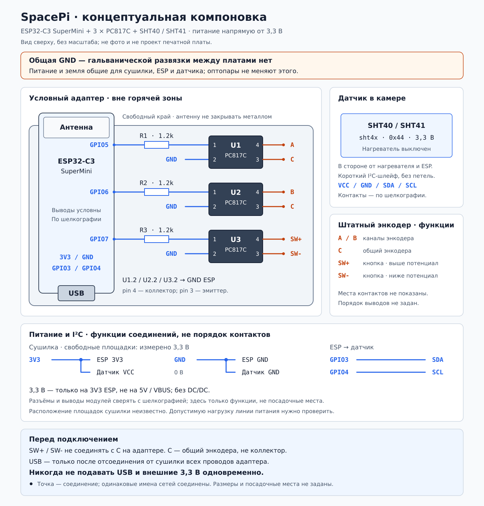

# Монтаж адаптера SpacePi

[Краткая инструкция](../README.md) · [Электрическая схема](../schema.svg) · [Компоновка](layout-proposal.svg)

## Текущий вариант

ESP32-C3 SuperMini питается через `3V3` и `GND` от свободных площадок штатной платы с измеренными 3,3 В. Отдельного DC/DC в этой сборке нет. Земли соединены через питание, поэтому оптопары **не обеспечивают гальваноразвязку между платами**.

GPIO5/6/7 управляют тремя PC817C через резисторы 1,2 кОм. Для SHT40/SHT41 предусмотрены GPIO3 — SDA, GPIO4 — SCL, питание 3,3 В и GND. Конфиг датчика добавлен, проверка на реальном устройстве ещё нужна.

## Размещение

1. ESP — у края адаптера, антенной к свободному пространству; под антенной и рядом с ней не размещать медь, проводку и металл. Зазоры брать из документации конкретной платы.
2. Три PC817 — рядом с разъёмом энкодера, метками первого вывода в одну сторону. Резисторы — со стороны GPIO. Не путать pin 4 (коллектор) и pin 3 (эмиттер).
3. Разъёмы питания, энкодера и датчика подписать; провода закрепить рядом с выходом для разгрузки пайки. Не ориентироваться на условный порядок контактов на рисунке вместо маркировки модуля.
4. Адаптер и ESP разместить вне горячей зоны. SHT40/SHT41 вынести в камеру, вдали от нагревателя, его воздушной струи и электроники. Не закрывать чувствительное отверстие датчика.
5. I²C вести коротким кабелем вдали от сетевых и силовых проводов. Подтяжки SDA/SCL — только к 3,3 В; если их нет на модуле, обычно подходят 4,7 кОм.

## Проверки до подключения

- Назначение площадок 3,3 В и 0 В, изоляция низковольтного питания от сети и запас мощности штатного источника должны быть подтверждены. Расположение площадок на схеме не задано.
- Вход `3V3` обходит стабилизатор SuperMini: требуется стабильное питание 3,3 В. Не подключать 5 В к этому выводу и не подавать 3,3 В на `5V/VBUS`.
- Пайка — только на полностью обесточенной сушилке. Для USB отсоединить **все соединения адаптера с сушилкой**; не питать его одновременно от USB и внешних 3,3 В.
- Сверить полярность SW+/SW− и выходов PC817. Включённая оптопара должна давать уверенный логический ноль под штатной нагрузкой; прозвонка не заменяет эту проверку.
- При запуске проверить в ESPHome Logs наличие SHT4x на I²C, обычно по адресу `0x44`, и правдоподобность показаний. Адрес конкретного модуля сверить с его документацией.

Все размеры, площадки и линии на эскизе условные. Это схема размещения, а не шаблон сверловки или готовые дорожки печатной платы.
